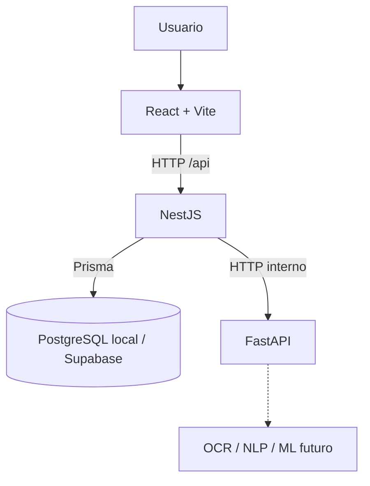

# Turniting

Turniting es una base para análisis académico asistido por inteligencia artificial. La F000 prepara una interfaz de estado y una arquitectura separada en servicios; no implementa todavía ingestión de documentos ni detección de escritura generada por IA.

> Turniting es una herramienta independiente de análisis probabilístico. No constituye un resultado oficial de Turnitin ni afirma reproducir su algoritmo propietario.

## Arquitectura



React consume exclusivamente la API NestJS. NestJS es responsable de persistencia y reglas de negocio. FastAPI expone las operaciones especializadas de IA y no se conecta a PostgreSQL.

## Stack

| Servicio | Tecnología | Puerto local |
|---|---|---:|
| Frontend | React, Vite, TypeScript | 8080 con Docker; 5173 en desarrollo |
| Backend | NestJS, TypeScript, Prisma | 3000 |
| Servicio IA | Python, FastAPI | 8000 |
| Base de datos | PostgreSQL | 5432 |

## Estructura

```text
backend/       API principal, Prisma y migraciones
frontend/      aplicación React y Nginx
ai-service/    API FastAPI ligera
docs/          arquitectura, instalación y despliegue
docker-compose.yml
```

## Requisitos

- Docker Desktop con Docker Compose v2 para ejecutar la pila local.
- Node.js y npm para los comandos de desarrollo y QA del backend/frontend.
- Python 3.12 o superior para ejecutar el servicio IA fuera de Docker.

## Inicio local con Docker

```powershell
Copy-Item .env.example .env
# Edit .env and replace POSTGRES_PASSWORD with a random alphanumeric value.
docker compose config
docker compose up --build -d
docker compose ps
```

Direcciones locales:

- Frontend: <http://localhost:8080>
- Backend: <http://localhost:3000/api/health>
- Base de datos: <http://localhost:3000/api/health/db>
- Integración con IA: <http://localhost:3000/api/health/ai>
- FastAPI: <http://localhost:8000/health>

Para detener los contenedores sin borrar la base de datos:

```powershell
docker compose down
```

El volumen local persiste entre reinicios. `docker compose down -v` lo elimina y debe usarse solo cuando se desee borrar esa base local.

## Variables de entorno

La plantilla raíz `.env.example` configura PostgreSQL local y `CORS_ORIGIN` para Docker Compose. Copia esa plantilla a `.env` y reemplaza `POSTGRES_PASSWORD` por un valor aleatorio antes de iniciar los servicios. `CORS_ORIGIN` acepta varios orígenes explícitos separados por comas; no admite comodines.

Para ejecutar servicios individualmente, consulta `backend/.env.example`, `frontend/.env.example` y `ai-service/.env.example`. Los valores de ejemplo son locales. Mantén URLs de base de datos, contraseñas y tokens fuera del frontend, del repositorio y de las imágenes Docker.

## Comandos frecuentes

```powershell
docker compose config --quiet
docker compose up --build -d
docker compose ps
docker compose logs -f backend ai-service db frontend
docker compose down
```

`docker compose down` conserva el volumen `turniting_pgdata`. No uses `docker compose down -v` salvo que quieras borrar la base local.

## Solución de problemas

- Si Compose indica que falta `POSTGRES_PASSWORD`, crea `.env` desde `.env.example` y establece un valor aleatorio local.
- Si un servicio no llega a `healthy`, revisa `docker compose ps` y `docker compose logs <servicio>` antes de reiniciarlo.
- Si un puerto local ya está ocupado, detén el proceso que lo usa o cambia el puerto publicado correspondiente en `docker-compose.yml`.
- Si falla la conexión a PostgreSQL después de cambiar la contraseña local, conserva la contraseña que inicializó el volumen o rota el rol de forma intencional. Borrar el volumen también borra los datos locales.

## Desarrollo y pruebas

Los comandos de cada paquete y la preparación local están en [docs/LOCAL_SETUP.md](docs/LOCAL_SETUP.md). La configuración no contiene credenciales reales; `.env.example` usa valores exclusivamente locales.

## Supabase y Cloud Run

La conexión a Supabase se realiza únicamente desde NestJS por PostgreSQL y Prisma. La guía de variables, SSL, pooling y migraciones está en [docs/SUPABASE_SETUP.md](docs/SUPABASE_SETUP.md). React no utiliza el Data API ni recibe credenciales de base de datos.

El despliegue separado de frontend, backend y servicio IA se documenta en [docs/CLOUD_RUN_DEPLOYMENT.md](docs/CLOUD_RUN_DEPLOYMENT.md). No se incluyen IDs de proyecto, URLs ni secretos no verificados.

## Documentación

- [Arquitectura](docs/ARCHITECTURE.md)
- [Instalación local](docs/LOCAL_SETUP.md)
- [Configuración de Supabase](docs/SUPABASE_SETUP.md)
- [Despliegue en Cloud Run](docs/CLOUD_RUN_DEPLOYMENT.md)
- [Cierre F000](docs/F000_FOUNDATION.md)
