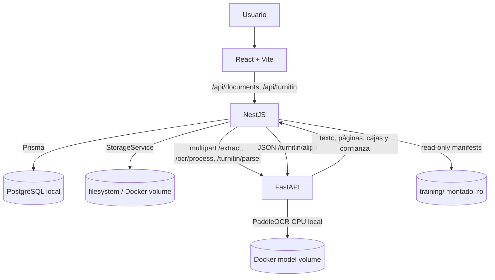

# Arquitectura

## Flujo



## Responsabilidades

### React + Vite

- Presenta el estado de los servicios, documentos y reportes Turnitin en `/documents`, `/documents/:id`, `/turnitin-reports` y `/turnitin-reports/:id`.
- Envía cargas y demás solicitudes únicamente a NestJS por medio de una capa HTTP centralizada.
- Usa una ruta relativa `/api` con el proxy de desarrollo o el reverse proxy local. En producción, `VITE_API_URL` se define al compilar el bundle.
- Valida extensión y tamaño en el cliente para orientar al usuario; NestJS repite las validaciones de seguridad.
- No conoce credenciales ni establece conexiones con PostgreSQL, Supabase, almacenamiento o FastAPI.

### NestJS

- Es la API principal y la única capa que accede a PostgreSQL.
- Valida extensión, MIME, firma del archivo y `MAX_UPLOAD_MB`; aplica CORS restringido, Helmet y `ValidationPipe` global.
- Guarda los binarios con nombres UUID mediante `StorageService`; la implementación local usa `UPLOAD_DIR` y no guarda binarios en PostgreSQL.
- Crea los metadatos/versiones y el texto extraído en PostgreSQL; los duplicados conservan documentos independientes con el mismo SHA-256.
- Expone carga, listado paginado, detalle, texto, borrado y reprocesamiento de documentos.
- Persiste clasificación, texto digital/OCR/canónico, bloques y confianza en `DocumentPage`; registra intentos e incidencias en `OcrRun`.
- Reconstruye `DocumentVersion.extractedText` en orden de página dentro de la misma transacción que guarda sus resultados OCR.
- Expone análisis OCR por documento, páginas por versión e historial OCR; envía el trabajo local a FastAPI con `AI_OCR_TIMEOUT_MS`.
- Expone carga y consulta paginada de reportes, fuentes y segmentos; reprocesamiento, asociación a `DocumentVersion` y registro/actualización de casos ground truth.
- Conserva cada PDF de reporte en `turnitin/<uuid>.pdf`; calcula SHA-256 antes de persistir metadatos y relaciones.
- Ejecuta comprobaciones reales de PostgreSQL y FastAPI en los endpoints de estado.
- Usa un cliente Prisma compartido. `AI_SERVICE_URL` identifica FastAPI y `AI_SERVICE_TIMEOUT_MS` limita la espera de extracción.
- Marca desactualizada la alineación Turnitin cuando cambia el texto canónico y no sintetiza geometría ausente durante un reparse OCR.

### FastAPI

- Provee `/health`, `POST /analyze/test`, `POST /extract`, `/ocr/status`, `/ocr/analyze`, `/ocr/process`, `POST /turnitin/parse`, `POST /turnitin/parse-ocr-text` y `POST /turnitin/align`.
- Extrae PDF con PyMuPDF, DOCX con python-docx, TXT con decodificación UTF-8/BOM y fallback, y clasifica PNG/JPEG como página única.
- Clasifica cada página como digital, escaneada, híbrida, vacía o no legible; solo envía páginas con imagen y texto insuficiente al motor local PaddleOCR en CPU.
- Conserva texto, orden de lectura, cajas observadas y confianza devuelta por PP-OCRv5 mobile para español/Latin; no inventa confianza ni geometría.
- Renderiza PDF con límites de DPI/píxeles/páginas, corrección de inclinación y mejora de contraste condicionada. El modelo se descarga una vez al volumen local `turniting_ai_models` y se carga desde ese volumen al reiniciar.
- No transmite documentos a servicios OCR externos ni accede a PostgreSQL.
- Interpreta exclusivamente etiquetas, porcentajes, filtros, fuentes y resaltados visibles en el reporte exportado; no recrea el algoritmo ni el detector de Turnitin.
- Conserva el texto raw de porcentajes como `<1%` y deja el valor numérico en `null` cuando el PDF no muestra uno.
- Alinea texto con normalización y similitud difusa para registrar estado, señales de metadatos y offsets en el texto original; los conteos y nombres son señales secundarias, no prueba de identidad.
- No accede a la base de datos ni estima si un texto fue generado por IA.
- Lee el puerto de escucha desde `PORT`.

### Almacenamiento local

- `UPLOAD_DIR` define el directorio de archivos en ejecución local.
- Docker Compose monta el volumen nombrado `turniting_uploads` en `/data/uploads`.
- Docker Compose monta el volumen nombrado `turniting_ai_models` en `/data/models/paddleocr` para los pesos de PaddleOCR.
- `docker compose down` conserva los archivos; `docker compose down -v` elimina ese volumen.
- `StorageService` aísla las operaciones `save`, `read`, `delete` y `exists` para permitir una implementación de almacenamiento futura.
- Los reportes se guardan bajo `UPLOAD_DIR/turnitin/` con directorio/archivo privados; la clave lógica acepta solo UUID y extensión PDF.

### PostgreSQL y Supabase

- PostgreSQL local corre como servicio Docker con volumen persistente y healthcheck `pg_isready`.
- F001, F002 y F003 aplican migraciones incrementales solo a PostgreSQL local. F003 agrega `DocumentPage` y `OcrRun`, además del estado OCR/alineación necesario; los binarios permanecen en almacenamiento local.
- `SUPABASE = DEFERRED_TO_F011`; no existe conexión remota de F001.

### Cloud Run

- `CLOUD_RUN = DEFERRED_TO_F011`; F001 no crea recursos GCP ni despliega imágenes.

## Datos de F001–F003

F001 define `User`, `Document`, `DocumentVersion` y `Analysis`. F002 agrega reportes y ground truth. F003 agrega una fila por página y un historial por ejecución OCR con UUID, estado, motor, modelo, páginas procesadas, confianza y duración. `DocumentVersion.extractedText` es la reconstrucción canónica por página. Los binarios quedan en almacenamiento local; el volumen de modelos contiene únicamente pesos públicos de PaddleOCR. No se generan muestras de entrenamiento ni detector de IA o motor de similitud.

## Datos de F004

F004 agrega `DatasetVersion`, `DatasetSource`, `DatasetArtifact`, `TrainingSplitManifest`, `TrainingSample` y `ModelVersion`. PostgreSQL guarda solo metadata (versiones, procedencia, licencias, estadísticas, hashes, splits y muestras locales); los Parquet públicos y los pesos viven fuera del repo y de la base de datos y se referencian como artefactos externos (`LOCAL` o `GOOGLE_DRIVE`, con ruta lógica y sin credenciales). NestJS lee los manifests de `TRAINING_DIR` (en Compose, `./training` montado en `/app/training` de solo lectura). Las muestras derivadas de Turnitin solo crean candidatos `MACHINE` desde `AI_FLAGGED`; `NOT_FLAGGED` nunca se convierte en `HUMAN`. Ningún modelo se marca `ACTIVE` ni participa del análisis en F004. Detalle en [F004_DATASET.md](F004_DATASET.md).

```
PUBLIC DATASETS → training pipeline → TURNITING_DATASET_V1 → DatasetVersion
                                                              ├── DatasetSource
                                                              ├── DatasetArtifact
                                                              └── TrainingSplitManifest → ModelVersion → CANDIDATE_MODEL_V2
TURNITIN REPORT → GroundTruthCase → TurnitinSegment → TrainingSample → futuras versiones de dataset
```

## Referencias técnicas

- [Documentación de NestJS: configuración](https://docs.nestjs.com/techniques/configuration)
- [Prisma ORM v6: fuentes de datos y `directUrl`](https://www.prisma.io/docs/v6/orm/prisma-schema/overview/data-sources)
- [Supabase: conexión a PostgreSQL](https://supabase.com/docs/guides/database/connecting-to-postgres)
- [Google Cloud: autenticación servicio a servicio en Cloud Run](https://docs.cloud.google.com/run/docs/authenticating/service-to-service)
