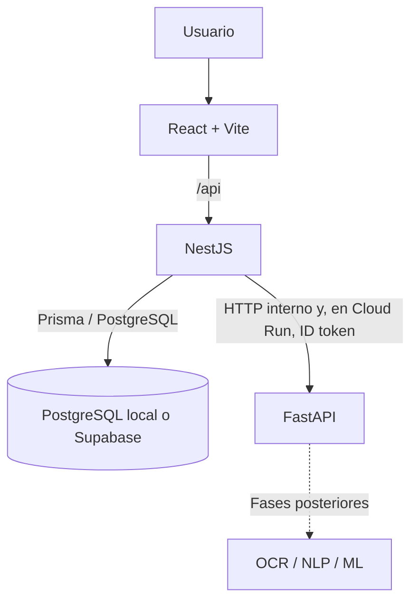

# Arquitectura

## Flujo

## Responsabilidades

### React + Vite

- Presenta el estado de los servicios y la información de alcance de F000.
- Llama únicamente a NestJS por medio de una capa HTTP centralizada.
- Usa una ruta relativa `/api` con el proxy de desarrollo o el reverse proxy local. En producción, `VITE_API_URL` se define al compilar el bundle.
- No conoce credenciales ni establece conexiones con PostgreSQL, Supabase o FastAPI.

### NestJS

- Es la API principal y la única capa que accede a datos.
- Valida la configuración y las solicitudes entrantes; aplica CORS restringido, Helmet y `ValidationPipe` global.
- Ejecuta comprobaciones reales de PostgreSQL y FastAPI en los endpoints de estado.
- Usa un cliente Prisma compartido. `AI_SERVICE_URL` identifica FastAPI; `AI_SERVICE_AUTH_MODE` permite desactivar autenticación en local o solicitar un ID token de Google en Cloud Run.

### FastAPI

- Provee `/health` y `POST /analyze/test` para comprobar la conexión desde NestJS.
- No accede a la base de datos y todavía no analiza documentos ni estima si un texto fue generado por IA.
- Lee el puerto de escucha desde `PORT`, como requiere Cloud Run.

### PostgreSQL y Supabase

- PostgreSQL local corre como servicio Docker con volumen persistente y healthcheck `pg_isready`.
- Supabase se usa como PostgreSQL gestionado. La conexión y las migraciones se configuran solo en el backend.
- La URL de aplicación `DATABASE_URL` y la URL directa para migraciones `DIRECT_URL` dependen del modo de conexión real elegido en el panel Supabase. No se deriva ni se inventa un host de pooler.

### Cloud Run

- Publica el frontend y la API principal; la API restringe CORS a los orígenes locales necesarios y al dominio del frontend.
- Mantiene FastAPI privado. NestJS presenta un ID token cuya audiencia es la URL del servicio FastAPI y recibe `roles/run.invoker` con el mínimo alcance.
- Los secretos de base de datos se inyectan desde Secret Manager y no se copian a las imágenes.

## Datos de F000

Los modelos iniciales son `User`, `Document` y `Analysis`, con IDs UUID. El esquema no crea todavía tablas para segmentos, reportes de Turnitin, muestras de entrenamiento ni versiones de modelos.

## Referencias técnicas

- [Documentación de NestJS: configuración](https://docs.nestjs.com/techniques/configuration)
- [Prisma ORM v6: fuentes de datos y `directUrl`](https://www.prisma.io/docs/v6/orm/prisma-schema/overview/data-sources)
- [Supabase: conexión a PostgreSQL](https://supabase.com/docs/guides/database/connecting-to-postgres)
- [Google Cloud: autenticación servicio a servicio en Cloud Run](https://docs.cloud.google.com/run/docs/authenticating/service-to-service)
