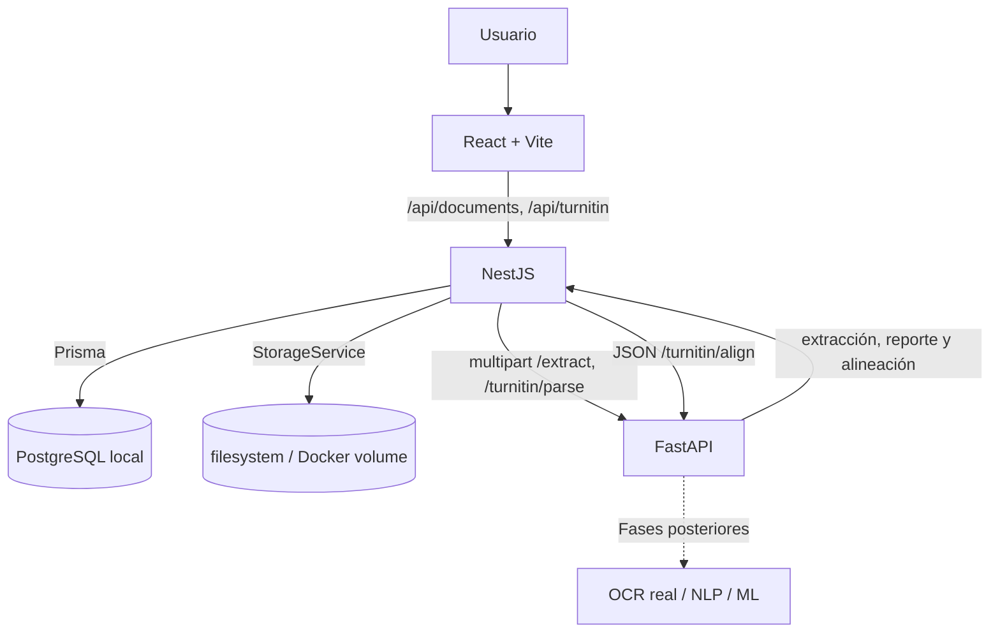

# Arquitectura

## Flujo

## Responsabilidades

### React + Vite

- Presenta el estado de los servicios, documentos y reportes Turnitin en `/documents`, `/documents/:id`, `/turnitin-reports` y `/turnitin-reports/:id`.
- Envía cargas y demás solicitudes únicamente a NestJS por medio de una capa HTTP centralizada.
- Usa una ruta relativa `/api` con el proxy de desarrollo o el reverse proxy local. En producción, `VITE_API_URL` se define al compilar el bundle.
- Valida extensión y tamaño en el cliente para orientar al usuario; NestJS repite las validaciones de seguridad.
- No conoce credenciales ni establece conexiones con PostgreSQL, Supabase, almacenamiento o FastAPI.

### NestJS

- Es la API principal y la única capa que accede a PostgreSQL.
- Valida extensión, MIME, firma del archivo y `MAX_UPLOAD_MB`; aplica CORS restringido, Helmet y `ValidationPipe` global.
- Guarda los binarios con nombres UUID mediante `StorageService`; la implementación local usa `UPLOAD_DIR` y no guarda binarios en PostgreSQL.
- Crea los metadatos/versiones y el texto extraído en PostgreSQL; los duplicados conservan documentos independientes con el mismo SHA-256.
- Expone carga, listado paginado, detalle, texto, borrado y reprocesamiento de documentos.
- Expone carga y consulta paginada de reportes, fuentes y segmentos; reprocesamiento, asociación a `DocumentVersion` y registro/actualización de casos ground truth.
- Conserva cada PDF de reporte en `turnitin/<uuid>.pdf`; calcula SHA-256 antes de persistir metadatos y relaciones.
- Ejecuta comprobaciones reales de PostgreSQL y FastAPI en los endpoints de estado.
- Usa un cliente Prisma compartido. `AI_SERVICE_URL` identifica FastAPI y `AI_SERVICE_TIMEOUT_MS` limita la espera de extracción.

### FastAPI

- Provee `/health`, `POST /analyze/test`, `POST /extract` multipart, `POST /turnitin/parse` multipart y el endpoint interno `POST /turnitin/align`.
- Extrae PDF con PyMuPDF, DOCX con python-docx y TXT con decodificación UTF-8/BOM y fallback; devuelve texto normalizado y métricas.
- Identifica PDF probablemente escaneados como `OCR_REQUIRED`; no ejecuta OCR.
- Interpreta exclusivamente etiquetas, porcentajes, filtros, fuentes y resaltados visibles en el reporte exportado; no recrea el algoritmo ni el detector de Turnitin.
- Conserva el texto raw de porcentajes como `<1%` y deja el valor numérico en `null` cuando el PDF no muestra uno.
- Alinea texto con normalización y similitud difusa para registrar estado, señales de metadatos y offsets en el texto original; los conteos y nombres son señales secundarias, no prueba de identidad.
- No accede a la base de datos ni estima si un texto fue generado por IA.
- Lee el puerto de escucha desde `PORT`.

### Almacenamiento local

- `UPLOAD_DIR` define el directorio de archivos en ejecución local.
- Docker Compose monta el volumen nombrado `turniting_uploads` en `/data/uploads`.
- `docker compose down` conserva los archivos; `docker compose down -v` elimina ese volumen.
- `StorageService` aísla las operaciones `save`, `read`, `delete` y `exists` para permitir una implementación de almacenamiento futura.
- Los reportes se guardan bajo `UPLOAD_DIR/turnitin/` con directorio/archivo privados; la clave lógica acepta solo UUID y extensión PDF.

### PostgreSQL y Supabase

- PostgreSQL local corre como servicio Docker con volumen persistente y healthcheck `pg_isready`.
- F001 y F002 aplican migraciones incrementales solo a PostgreSQL local. F002 agrega `TurnitinReport`, `TurnitinSource`, `TurnitinSegment` y `GroundTruthCase`; no guarda binarios PDF en la base.
- `SUPABASE = DEFERRED_TO_F011`; no existe conexión remota de F001.

### Cloud Run

- `CLOUD_RUN = DEFERRED_TO_F011`; F001 no crea recursos GCP ni despliega imágenes.

## Datos de F001

F001 define `User`, `Document`, `DocumentVersion` y `Analysis`. F002 agrega los modelos de reportes y ground truth con IDs UUID. Los archivos binarios permanecen en almacenamiento local. `DocumentVersion` conserva la clave de almacenamiento, SHA-256, texto extraído, conteos, página y advertencias. Los segmentos Turnitin guardan tipo, página, texto visible, bbox, color, fuente opcional y offsets de alineación; no se generan muestras de entrenamiento ni versiones de modelos.

## Referencias técnicas

- [Documentación de NestJS: configuración](https://docs.nestjs.com/techniques/configuration)
- [Prisma ORM v6: fuentes de datos y `directUrl`](https://www.prisma.io/docs/v6/orm/prisma-schema/overview/data-sources)
- [Supabase: conexión a PostgreSQL](https://supabase.com/docs/guides/database/connecting-to-postgres)
- [Google Cloud: autenticación servicio a servicio en Cloud Run](https://docs.cloud.google.com/run/docs/authenticating/service-to-service)
