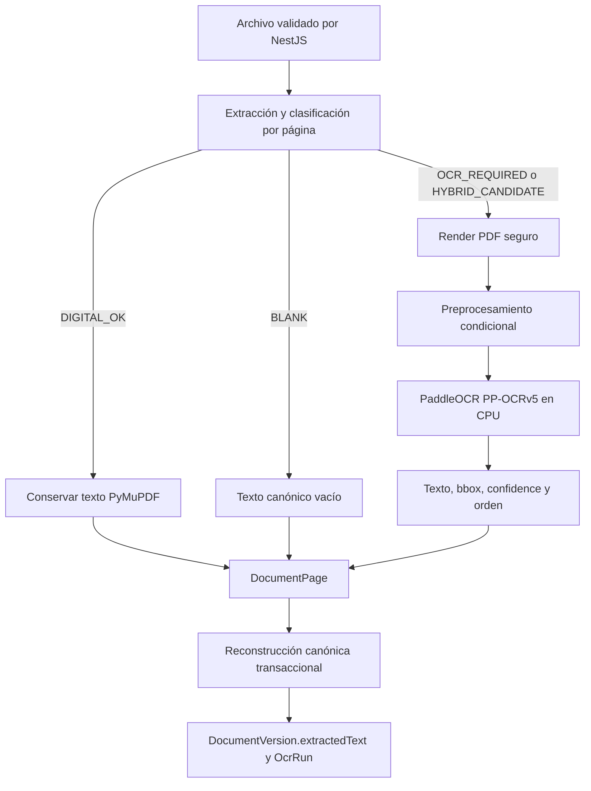

# F003: OCR selectivo y reconstrucción documental

## Objetivo y límites

F003 recupera texto de páginas escaneadas de forma local. Analiza cada página antes de llamar al motor, conserva texto digital existente y reconstruye `DocumentVersion.extractedText` desde las páginas en orden ascendente. Acepta PDF, PNG y JPEG. El procesamiento de OCR utiliza PaddleOCR en CPU; no envía documentos a APIs de OCR ni a servicios externos.

F003 no implementa modelos de detección de escritura con IA, análisis de similitud, datasets F004 ni despliegues remotos. Supabase y Cloud Run permanecen `DEFERRED_TO_F011`.

## Flujo



FastAPI realiza clasificación, render y reconocimiento. NestJS valida el archivo, llama FastAPI y persiste páginas, texto y el historial OCR en PostgreSQL local. Los documentos originales y los pesos del modelo usan volúmenes Docker independientes.

## Clasificación selectiva

`classify_page_for_ocr()` combina texto digital, palabras, área de imágenes y tinta visual. Los valores por defecto viven en `ai-service/app/core/config.py`:

| Variable | Valor por defecto | Uso |
|---|---:|---|
| `OCR_MIN_DIGITAL_CHARS` | 20 | Caracteres mínimos extraíbles |
| `OCR_MIN_DIGITAL_WORDS` | 4 | Palabras mínimas extraíbles |
| `OCR_IMAGE_AREA_RATIO` | 0.15 | Cobertura de imagen que puede indicar una página escaneada |
| `OCR_BLANK_PAGE_THRESHOLD` | 0.004 | Fracción de tinta por debajo de la cual se considera vacía |
| `OCR_LOW_CONFIDENCE_THRESHOLD` | 0.60 | Marca bloques con confianza menor a este valor |

Clasificaciones internas: `DIGITAL_OK`, `OCR_REQUIRED`, `HYBRID_CANDIDATE`, `BLANK` y `UNREADABLE`. Una página digital válida y una vacía no llegan al motor. Una página híbrida conserva primero el texto PyMuPDF, procesa la página visual y añade únicamente bloques OCR no duplicados. La versión actual procesa la página completa; la separación de regiones híbridas queda como mejora futura.

## Motor, versiones y cache

| Campo | Valor F003 |
|---|---|
| `OCR_ENGINE` | `paddleocr` |
| `OCR_ENGINE_VERSION` | `3.7.0` |
| `OCR_LANGUAGE` | `es` |
| `OCR_MODEL` | `PP-OCRv5_mobile_det+latin_PP-OCRv5_mobile_rec` |
| `OCR_PIPELINE_VERSION` | `f003-v1` |
| Dispositivo | CPU |
| `OCR_CPU_THREADS` | `2` |
| `OCR_DPI` | `220` |
| PaddlePaddle | `3.3.0` |
| OpenCV contrib (PaddleX OCR-core requirement) | `4.10.0.84` |
| NumPy | `1.26.4` |
| ModelScope adapter dependency | `1.36.3` |

La inferencia CPU se inicializa con `enable_mkldnn=False`. PaddlePaddle 3.3.x tiene un defecto conocido en el conversor PIR/oneDNN que puede detener `predict()` con `ConvertPirAttribute2RuntimeAttribute`; la ruta sin oneDNN mantiene inferencia local en CPU. Véase [PaddleOCR issue #17869](https://github.com/PaddlePaddle/PaddleOCR/issues/17869).

Se fija el detector móvil oficial `PP-OCRv5_mobile_det` y el reconocedor Latin `latin_PP-OCRv5_mobile_rec` para español. La orientación de página permanece activa para rotaciones; se desactiva orientación por línea y oneDNN, y se limitan los hilos a `OCR_CPU_THREADS=2` para ajustar la inferencia local a la memoria disponible. PaddleOCR publica 4.7 MB para el detector móvil frente a 84.3 MB para el detector server y recomienda el móvil para entornos de menor recurso ([catálogo oficial](https://www.paddleocr.ai/main/en/version3.x/pipeline_usage/OCR.html)).

Las versiones de PaddleOCR/PaddlePaddle/OpenCV/NumPy están fijadas en `ai-service/requirements-ocr.txt`; la dependencia del adaptador PaddleX está fijada en `ai-service/requirements-models.txt`. PaddleOCR descarga los modelos durante el warmup; el directorio lógico `OCR_MODEL_DIR=/data/models/paddleocr` y `PADDLE_PDX_CACHE_HOME` apuntan al volumen `turniting_ai_models`. El script `ai-service/scripts/warmup_ocr.py` reconoce texto sintético y deja un marcador de inicialización. Al reiniciar, FastAPI precarga desde ese volumen cuando encuentra el marcador. Los pesos y documentos reales no se agregan al repositorio.

PaddleX 3.7 comprueba el nombre de distribución `opencv-contrib-python==4.10.0.84` para habilitar su extra `ocr-core`; por eso se usa ese wheel en lugar del wheel `-headless` sugerido normalmente para Docker. No se llama ninguna API de ventana/GUI; `libgl1` y `libglib2.0-0` solo resuelven bibliotecas de runtime que el wheel declara al importarse.

Para instalar en local se requiere Python 3.12, porque la combinación fijada de NumPy/PaddlePaddle dispone de ruedas compatibles para esa versión. El primer warmup requiere red para descargar pesos públicos del modelo; una vez cacheados, la inferencia de los documentos es local.

## Render y preprocesamiento

- PyMuPDF respeta la geometría/rotación de la página y rasteriza por defecto a `OCR_DPI=220`, dentro del rango de 220–250 DPI requerido por F003.
- `OCR_MAX_RENDER_PIXELS=20000000` limita cada render; se reduce el DPI si es posible y se devuelve `OCR_IMAGE_TOO_LARGE` cuando no se puede cumplir el límite.
- PNG/JPEG se decodifican con Pillow, se aplica orientación EXIF y se comprueba MIME real, formato y dimensiones antes de convertir a una matriz RGB.
- OpenCV convierte a escala de grises. CLAHE se aplica cuando el rango de contraste medido es inferior a `OCR_CONTRAST_RANGE=70`.
- La inclinación se estima con Hough y se corrige solo si supera `OCR_DESKEW_MIN_ANGLE=1.0` grados. No se aplica binarización obligatoria.
- Las páginas se procesan secuencialmente; `OCR_MAX_PAGES_PER_RUN=150`, `OCR_TIMEOUT_MS=120000` y `OCR_MAX_CONCURRENT_JOBS=1` limitan coste y concurrencia.

## Texto, bbox y confidence

Cada bloque conserva el texto y confidence que entrega el motor, un `readingOrder` de arriba a abajo/izquierda a derecha y un bbox `{x0,y0,x1,y1}` escalado a las dimensiones de página. No se inventan confidence ni cajas si PaddleOCR no las entrega. `lowConfidence` usa el umbral centralizado.

Confidence de página/documento se pondera por caracteres: `sum(confidence_bloque * caracteres_bloque) / sum(caracteres_con_confidence)`. Solo cuentan bloques OCR con confidence real; páginas digitales no entran en la media. `DocumentPage.ocrMetadata` guarda los bloques, warnings, clasificación, proporción de imagen, inclinación y tiempo del procesamiento.

Para PDF híbridos, el texto canónico es el texto digital original seguido por los bloques OCR que no son duplicados; la comparación ignora diferencias Unicode/espacios y marca duplicados cuando la similitud textual alcanza el umbral configurado en el código. No se corrigen acentos, puntuación ni estilo.

## Persistencia y API

- `DocumentPage` tiene una fila por página y versión (`documentVersionId`, `pageNumber` único). Guarda texto digital, OCR, canónico, método, bbox/confidence agregados y metadata.
- `DocumentVersion.extractedText` es la unión del `canonicalText` de páginas ordenadas. Si cambia, las alineaciones Turnitin asociadas se marcan obsoletas.
- `OcrRun` registra motor, versiones, idioma/modelo/pipeline, configuración, páginas solicitadas/procesadas/omitidas/fallidas, duración, warnings y error seguro. Cada intento queda en el historial.
- La escritura de páginas, la reconstrucción y el resultado de `OcrRun` se guardan dentro de una transacción. Ante error se preservan el texto y estado previos y la ejecución queda fallida cuando la base permite registrarlo.
- Borrar un documento aplica las relaciones `ON DELETE CASCADE` a páginas y ejecuciones, luego limpia el archivo original.

Rutas principales:

| Ruta | Función |
|---|---|
| `POST /api/documents` | PDF/DOCX/TXT/PNG/JPEG y extracción inicial |
| `POST /api/documents/:id/ocr` | OCR selectivo o forzado |
| `GET /api/documents/:id/pages` | Resumen de páginas |
| `GET /api/document-versions/:versionId/pages/:pageNumber` | Detalle de página y bloques |
| `GET /api/document-versions/:versionId/ocr-runs` | Historial OCR |
| `POST /api/turnitin/reports/:id/ocr-reparse` | OCR local y reparse de texto de reporte escaneado |
| `GET /ocr/status` | Estado/cache del motor FastAPI |
| `POST /ocr/analyze` | Clasificación sin reconocimiento |
| `POST /ocr/process` | Reconocimiento de páginas seleccionadas |

El reparse OCR de reportes Turnitin no crea fuentes, segmentos, resaltados ni bbox inexistentes en el PDF. Si el parser no puede sustentar un dato en el texto/OCR observado, lo deja ausente.

## Fixtures y QA reproducible

Todos los archivos de QA son sintéticos y los genera `ai-service/scripts/create_synthetic_ocr_fixtures.py`; no se usan documentos privados. Ejecutar desde la raíz:

```powershell
docker compose build --no-cache
docker compose up -d
docker compose exec ai-service python -m scripts.warmup_ocr
docker compose restart ai-service
docker compose exec ai-service python -m scripts.create_synthetic_ocr_fixtures /tmp/f003-synthetic
docker compose exec ai-service python -m scripts.evaluate_synthetic_ocr /tmp/f003-synthetic
```

La evaluación imprime clasificaciones, páginas procesadas/omitidas, llamadas al motor, CER/WER, confianza, bloques de baja confianza, tiempos y memoria máxima observada. Los umbrales de aceptación son CER ≤ 0.05 y WER ≤ 0.10 para el escaneo limpio; para rotación de 90° CER ≤ 0.10 y WER ≤ 0.15. También comprueba OCR cero en PDF digital, páginas vacías omitidas, PDF híbrido y ausencia de fallos de página. Los resultados de una corrida deben transcribirse al cierre F003; no se ajusta ground truth para ocultar errores.

Suites locales:

```powershell
# ai-service (dentro de su entorno Python)
ruff check .
pytest

# backend
npm run lint
npm test
npm run test:e2e
npm run build

# frontend
npm run lint
npm run build
```

## Seguridad y límites conocidos

NestJS y FastAPI validan extensión/MIME y firma/contenido. Pillow protege contra decompression bombs; PyMuPDF no ejecuta JavaScript ni adjuntos. No se admiten TIFF multipágina, HEIC, BMP, GIF ni SVG. Los archivos permanecen en storage local; solo la descarga inicial de pesos necesita red. El primer OCR puede tardar por inicialización/carga del modelo. El procesamiento no promete OCR de escritura manuscrita ni separación de columnas complejas. En páginas híbridas se reconoce la página completa y se deduplican bloques de texto, en lugar de recortar automáticamente la región escaneada.

## Resultado de cierre

### Evaluación sintética y calidad

Corrida medida con PaddleOCR local en CPU sobre nueve fixtures sintéticos (12 páginas). Las páginas se clasificaron como 2 `DIGITAL_OK`, 8 `OCR_REQUIRED`, 1 `HYBRID_CANDIDATE` y 1 `BLANK`. La evaluación completó en 74,621 ms, con inicialización del modelo en 3,599 ms, media de 7,723 ms por página OCR y máximo de memoria observado de 1,219.98 MB.

| Caso | Resultado observado |
|---|---|
| PDF digital | 0 llamadas OCR; `DIGITAL`; texto digital conservado |
| PDF escaneado limpio | CER 0.0056; WER 0.0000; 4 bbox válidos; confidence 0.9948; 25 palabras |
| PDF rotado 90° | CER 0.0056; WER 0.0000; texto recuperado; corrección de orientación reportada a 270° |
| PDF inclinado 3° | skew corregido −2.946°; CER 0.0056; WER 0.0000 |
| PDF de bajo contraste | CLAHE aplicado; CER 0.0056; WER 0.0000 |
| PDF híbrido de 4 páginas | 1 digital, 1 OCR, 1 vacía sin OCR, 1 candidata híbrida; 2 páginas reconocidas, 2 omitidas; método final `HYBRID`; 0 OCR innecesario |
| PNG / JPEG | OCR exitoso, una página por imagen; CER 0.0056 y WER 0.0000 en ambos |
| Reporte Turnitin escaneado | OCR reparse recuperó `AI_WRITING` 67%; estado `PARTIAL`; 0 fuentes, 0 segmentos y 0 bbox inventados |

Las tildes de la ground truth sintética se conservaron en el texto canónico. En los casos reconocidos no hubo bloques de baja confianza ni bbox inválidos. El preprocesamiento no fuerza umbral/binarización. Las diez verificaciones de aceptación del script pasaron, incluidos cero OCR en páginas digitales, omisión de páginas digitales/vacías, calidad CER/WER, orientación, método híbrido, recuperación Turnitin y ausencia de fallos de página.

### Persistencia, regresión y ejecución local

- La migración `20261015231053_f003_selective_ocr` se aplicó a PostgreSQL local; Prisma validó el schema, generó el cliente y `prisma migrate status` confirmó cinco migraciones con el esquema al día.
- Después de reiniciar PostgreSQL, backend, FastAPI y frontend, los tres documentos sintéticos permanecieron `EXTRACTED`/`COMPLETED`; las páginas, el texto canónico y el historial OCR siguieron disponibles. El reporte Turnitin sintético siguió `PARTIAL` con el score recuperado.
- En cada versión sintética se observaron una fila `DocumentPage` y una `OcrRun`; tras el borrado, las filas `Document`, `DocumentVersion`, `DocumentPage` y `OcrRun` quedaron en cero y el archivo original ya no existía. El reporte sintético y su archivo también se eliminaron.
- Después del reinicio FastAPI informó PaddleOCR 3.7.0, modelo móvil PP-OCRv5, `modelReady=true` y `modelCacheConfigured=true`; el volumen `turniting_ai_models` conservó los pesos.
- La UI del detalle sintético mostró texto reconstruido, confianza, aviso de contraste y la fila por página con método, conteos y confianza. El indicador global muestra F003. El archivo probado era sintético.
- QA final: backend lint, 46 pruebas unitarias, 26 e2e y build; frontend lint/build y smoke de navegador; AI Ruff y 48 pruebas; Prisma format/validate/generate/migrate status; Docker build no-cache completo y rebuild del frontend actualizado. El lint backend conserva una advertencia `no-control-regex` en la sanitización de nombres de archivo; el comando termina correctamente.
- Los cuatro servicios Compose (`frontend`, `backend`, `ai-service`, `db`) estuvieron saludables. Los archivos privados, archivos de modelos y el directorio de adjuntos local no forman parte del cambio Git.
- Se crearon solo cuatro registros sintéticos para la verificación API/UI; se eliminaron mediante API y se confirmó la limpieza en PostgreSQL y storage. No se cargaron, modificaron ni compararon documentos privados.

### Límites observados

El reconocedor recupera texto y geometría del motor, pero un reporte Turnitin escaneado no permite reconstruir con exactitud resaltados vectoriales, colores, fuentes, segmentos ni sus bbox; esos campos quedan vacíos y el reporte parcial. En páginas híbridas se reconoce la página completa y se deduplican bloques, sin recorte automático de regiones. OCR de manuscritos y columnas complejas no está garantizado. Ninguna API OCR externa ni despliegue remoto se utilizó.
