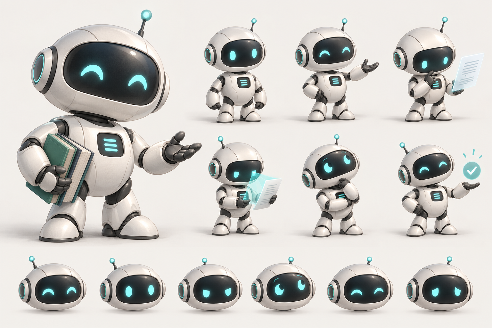

# Sistema de identidad, estados y animación de la mascota Turniting

**Estado:** especificación visual y de interacción para producción
**Versión:** 1.0
**Ámbito:** mascota reutilizable para Análisis rápido y, más adelante, carga de documentos, historial, reportes, estados vacíos y errores.

## Lámina visual



Esta lámina fija la dirección visual de las poses y expresiones. El personaje implementado en la aplicación es un SVG por capas, así que sus gestos y colores de estado siguen siendo adaptables y accesibles.

## 1. Decisión de diseño

La mascota, con nombre de trabajo **Turni**, será un robot compacto de escritorio: una herramienta de lectura y análisis con una presencia serena, precisa y cercana. Su silueta combina una cabeza de cápsula amplia, visor grafito expresivo, cuerpo corto de cerámica blanca y articulaciones grafito. Una antena corta con núcleo turquesa sirve como indicador de estado. Un pequeño panel en el torso puede mostrar trazos de texto, un check o una señal de espera.

Turni acompaña la tarea; no representa una persona, no suplanta al producto y no interpreta por sí mismo los resultados. La expresión y el color de estado comunican el estado de la interfaz. Las métricas, porcentajes y conclusiones siguen siendo los que entrega el análisis real.

La forma debe conservar una identidad reconocible en tres cuartos y frontal, ser construible como piezas separadas y mantener lectura a 80 px. La estética usa volumen pseudo-3D mediante contornos, sombras cortas y brillos contenidos; evita render fotorrealista, reflejos intensos, estética gaming y gradientes neón.

## 2. Diseño del personaje

### Silueta y proporciones

Usar una mesa de diseño de 100 unidades de alto, desde la antena hasta la base de los pies. Mantener el centro de masa bajo y la cabeza ligeramente adelantada para transmitir atención sin imitar una anatomía humana.

| Pieza | Proporción orientativa | Instrucción visual |
|---|---:|---|
| Cabeza y carcasa | 36–40 % de la altura; ancho máximo 62–68 % del alto total | Cápsula rectangular, esquinas generosas y laterales levemente biselados. Debe dominar la silueta sin parecer un casco industrial. |
| Visor | 62–70 % del ancho de la cabeza; 42–48 % de su alto | Una única ventana horizontal de grafito profundo, con borde interior sutil. Sin boca humana. |
| Ojos digitales | Cada ojo ocupa 10–13 % del ancho del visor | Formas simples de luz turquesa pálida. Separación suficiente para que se lean a 80 px. Los cambios de emoción se resuelven con forma, inclinación y distancia, no con muchos detalles. |
| Antena | 10–14 % de la altura total | Vástago corto, base grafito y difusor turquesa redondeado. El punto luminoso es el único brillo sostenido. |
| Torso | 25–29 % de la altura | Bloque compacto con hombros suaves; centro del pecho con una pantalla pequeña de una o dos líneas. |
| Brazos y manos | 22–27 % de la altura, desde el hombro | Dos segmentos redondeados por brazo; manos tipo pinza de dos dedos anchos para sostener o señalar sin dedos realistas. |
| Piernas y pies | 22–26 % de la altura | Segmentos cortos, pies anchos y sencillos; suficientes para sentarse, levantarse y correr en el sitio. |

El rostro debe funcionar sin texto. A 80–120 px se simplifican el borde interior del visor, las costuras del cuerpo y las partículas; se conservan la antena, los ojos, la forma de la cabeza y el gesto principal. No reducir el tamaño de las zonas de interacción de la interfaz para acomodar al personaje.

### Materiales y acabados

- **Carcasa:** blanco frío o gris perla mate, con sombreado suave en el borde inferior y un brillo corto en el borde superior izquierdo.
- **Visor y articulaciones:** grafito azulado casi negro; acabado satinado, sin reflejos especulares grandes.
- **Juntas:** grafito medio, claramente separadas de la carcasa para que las piezas puedan riggearse y se lean en móvil.
- **Acentos:** teal reservado a ojos, antena, scan line y detalles funcionales del pecho.
- **Sombra:** elipse de suelo gris fría, tenue y fija al suelo. Puede comprimirse al saltar o levantarse, pero no debe crear un escenario pesado.
- **Profundidad:** usar una sombra de contacto, una cara lateral de tono gris y un highlight discreto. Mantener una sola fuente de luz arriba a la izquierda.

### Paleta vinculada a Turniting

Los siguientes valores toman como base los tokens existentes del frontend (`frontend/src/index.css`); estados de advertencia y error aprovechan los colores funcionales del sistema.

| Uso | Token / valor | Aplicación |
|---|---|---|
| Fondo de escena | `--canvas` `#F8FAFC` | Fondo transparente preferido; si se necesita una placa, usar este neutro. |
| Carcasa | `--surface` `#FFFFFF` | Superficie principal del robot. |
| Sombra de carcasa | `--line` `#E2E8F0` | Separación de paneles y sombra clara, no contorno negro grueso. |
| Articulación | `--ink-soft` `#334155` | Juntas, base de antena y detalles estructurales. |
| Visor | `--ink` `#0F172A` | Ventana del rostro y contraste principal. |
| Teal principal | `--teal` `#0D9488` | Antena, scan line, líneas de datos. |
| Teal oscuro | `--teal-dark` `#0F766E` | Contornos/acento cuando se requiera más contraste. |
| Teal luminoso | `--teal-bright` `#14B8A6` | Núcleo de ojos, destello de antena y un brillo breve. No usarlo como neón permanente. |
| Teal pálido | `--teal-pale` `#F0FDFA` | Halo muy tenue o panel de éxito. |
| Éxito | `--green` `#157359`, `--green-pale` `#EEF7F4` | Check, luz de pecho y confirmación; el cuerpo conserva sus colores. |
| Advertencia | `--amber` `#9A6715`, `--amber-pale` `#FEF9EC` | Lente de antena e icono de atención. |
| Error | `--red` `#9F3A3A`, `--red-pale` `#FDF2F2` | Solo para el indicador del estado de error y pequeños símbolos. |

La mascota no comunicará estados solo mediante color: cada color funcional se acompaña de pose, símbolo y texto accesible. No recolorear todo el robot al cambiar de estado.

## 3. Hoja de poses

Todas las poses parten de una misma construcción, pivotes y cámara. El eje de mirada indica hacia dónde orientan los ojos y la cabeza; “lado UI” significa hacia el panel de texto o resultados, no hacia fuera de la pantalla.

| ID / pose | Silueta y extremidades | Cabeza, mirada y accesorio | Uso |
|---|---|---|---|
| `POSE_SEATED_IDLE` | Sentado en una base mínima o en el suelo; torso vertical relajado; manos descansan junto a las caderas; una pierna ligeramente adelantada. | Cabeza inclinada 4° al lado UI; mirada neutra. Antena en pulso lento. | Espera sin texto. |
| `POSE_READY` | Se conserva la posición sentada; torso se eleva un poco; manos se separan del suelo como preparación. | Cabeza sube 5° y ojos se fijan en el documento; antena ilumina una vez. | Texto disponible. |
| `POSE_STAND_UP` | Mano izquierda se apoya; pies se colocan debajo del torso; cuerpo termina erguido con brazos próximos al pecho. | Mirada sigue el documento y luego se dirige al lado UI. | Comienzo de análisis. |
| `POSE_READING` | De pie, codos flexionados; una mano sostiene el borde inferior del documento flotante y la otra estabiliza el lado opuesto. | Ojos recorren una línea horizontal; documento a la altura del pecho. | Lectura de texto o párrafos. |
| `POSE_ANALYZING` | Pies firmes, torso inclinado 3° hacia delante, antebrazos abiertos en pose de escaneo. | Ojos estrechos por foco, no por enfado; pecho muestra dos trazos teal; scan line atraviesa el documento. | Análisis en curso. |
| `POSE_RUN_IN_PLACE` | Zancada corta con codos alternados; desplazamiento neto cero. El cuerpo se inclina 7° hacia delante. | Mirada enfocada al lado UI; antena se inclina con retraso. Dos líneas de velocidad cortas. | Transición breve opcional; nunca representa avance matemático. |
| `POSE_THINKING` | De pie, una mano toca la barbilla del visor/pecho sin simular un rostro humano; otra mano descansa cerca del torso. | Cabeza inclinada 8°; ojos miran ligeramente arriba y vuelven al contenido. Una partícula geométrica pequeña puede orbitar. | Espera larga o pausa del servicio. |
| `POSE_SUCCESS_THUMB` | Cuerpo erguido; mano cercana al usuario hace pulgar arriba simplificado; hombros abiertos. | Ojos curvos/arqueados de forma digital; pecho muestra check. Dos o tres destellos cortos. | Operación completada. |
| `POSE_RESULT_SIDEKICK` | Turni se mueve a un lateral del panel y queda de pie, brazos bajos; conserva espacio central libre. | Mirada acompaña el resultado, no lo tapa. Antena estable. | Revelado y lectura de resultados. |
| `POSE_WARNING` | Pies firmes; torso recto; una mano se eleva unos centímetros con palma abierta. | Ojos atentos, sin agrandarse; luz ámbar y triángulo pequeño. | Atención requerida sin fallo. |
| `POSE_ERROR` | Hombros bajan ligeramente; codos cerca del cuerpo; manos visibles y neutrales. | Ojos asimétricos por un instante y luego estables; luz roja pequeña; sin llamas ni explosiones. | Error genérico. |
| `POSE_NETWORK` | Cuerpo gira un poco hacia un icono de conexión separado; mano indica ese icono. | Ojos siguen un enlace discontinuo; antena emite un pulso de búsqueda suave. | Timeout o servicio no disponible. |
| `POSE_FILE_INSPECT` | Robot sostiene un documento a dos manos y acerca una lupa o aro de escaneo al borde. | Cabeza inclinada 6°; mirada al formato del documento. | Archivo ilegible, corrupto o incompatible. |
| `POSE_EMPTY` | Manos abiertas a la altura del torso, codos flexionados; postura acogedora, sin encogimiento exagerado. | Mira el área de entrada vacía y después al usuario. | Análisis solicitado sin texto. |
| `POSE_RESET_SWEEP` | Una mano hace un barrido corto de lado a lado; resto del cuerpo vuelve a posición sentada. | La mirada sigue el barrido; el panel del pecho vuelve a quedar vacío. | Limpiar/restablecer. |
| `POSE_COPY_ACK` | Mano acerca una tarjeta duplicada al pecho; aparece check pequeño. | Ojos hacen un guiño digital corto; flash teal con opacidad baja. | Copia confirmada. |

## 4. Hoja de expresiones

Expresar la emoción con ojos, inclinación y ritmo, sin añadir cejas humanas ni boca permanente. Todas las expresiones deben seguir siendo legibles en el visor a escala móvil.

| Expresión | Tratamiento de ojos | Inclinación/ritmo | Indicador opcional |
|---|---|---|---|
| `EXPR_NEUTRAL` | Dos ojos redondeados, luminancia baja-media, mirada centrada. | Cabeza estable con blink de 120 ms cada 3–5 s. | Antena con un punto teal estable. |
| `EXPR_ATTENTIVE` | Ojos un poco más abiertos y alineados hacia el documento. | Cabeza se levanta 3–5° y frena suavemente. | Pulso único de antena. |
| `EXPR_FOCUSED` | Ojos ligeramente estrechos, separados y dirigidos al área de lectura. | Microseguimiento izquierda-derecha; pausa breve al cambiar de línea. | Trazos teal en el panel del pecho. |
| `EXPR_THOUGHTFUL` | Ojos no simétricos por desplazamiento de pupilas, sin agrandar el visor. | Tilt de 6–8°; pausa; pequeño retorno al contenido. | Una forma geométrica tenue, no un gran signo de interrogación. |
| `EXPR_HAPPY` | Curva suave ascendente formada por la luz ocular o dos ojos redondeados con inclinación positiva. | Un único bounce pequeño, sin sacudida repetida. | Check en el pecho y 2–3 sparkles. |
| `EXPR_CAUTION` | Ojos centrados, apertura normal y mirada fija. | Cabeza estable; gesto de palma abierta. | Ámbar en antena y triángulo pequeño. |
| `EXPR_CONFUSED` | Un ojo desplaza su luz unos píxeles; evitar cruzar los ojos. | Tilt de 4° y retorno neutral. | Símbolo de error pequeño solo en el contexto. |
| `EXPR_RECONNECT` | Ojos miran al icono de enlace; un segmento del ojo puede atenuarse una sola vez. | Dos pulsos espaciados, no parpadeo continuo. | Trazos de conexión discontinuos. |
| `EXPR_INSPECT` | Ojos convergen hacia el documento, con un barrido corto. | Cabeza acompaña el borde inspeccionado. | Aro/lupa del documento. |
| `EXPR_ACK` | Guiño digital de un ojo durante 100–140 ms y vuelta a neutral. | Cabeza asiente una vez, apenas perceptible. | Mini-check teal. |

## 5. Estados de la mascota

Los 16 estados siguientes son nombres canónicos de interacción. Las frases entre comillas son propuestas de estado visible, no deben duplicarse si la UI ya presenta un mensaje equivalente.

| # | Estado canónico | Entrada/condición | Pose y animación | Texto sugerido / duración |
|---:|---|---|---|---|
| 01 | `IDLE` | No hay análisis en curso ni texto válido. | `POSE_SEATED_IDLE`; respiración apenas visible, blink ocasional, pulso lento de antena y una mirada lateral esporádica. Loop de 3–5 s. | “Pega o escribe texto para comenzar.” Persistente y silencioso. |
| 02 | `READY` | Existe texto suficiente para habilitar el botón Analizar. | Transición sentada→atenta; cabeza sube, mirada busca el documento y antena hace un pulso. | “Listo para analizar.” 0.5–1 s; después pose preparada. |
| 03 | `STAND_UP` | El usuario confirma Analizar y se acepta la solicitud. | Mira el documento, apoya una mano, coloca pies, se impulsa y termina erguido. Antena/manos tienen retraso secundario breve. | “Voy a empezar.” 0.7–1.2 s; entrada obligatoria antes de lectura. |
| 04 | `READING` | La app está preparando o recorriendo el texto recibido. | Documento sostenido; ojos recorren de izquierda a derecha, la cabeza acompaña; scan line avanza sobre el documento, no sobre la cara. | “Leyendo el texto…” 1.5–2.5 s si el estado representa una etapa real; si no hay señal backend, puede usarse como transición breve sin prometer progreso. |
| 05 | `ANALYZING` | La solicitud está pendiente de resultado y no hay error. | Pose concentrada con scan repetible y trazos en el pecho; loop calmado de 1.8–2.6 s, antena pulsa un poco más rápido que en idle. | “Analizando señales…” mientras esté pendiente. El loop puede repetirse sin avanzar ni simular una escala. |
| 06 | `RUNNING` | Transición visual opcional para enfatizar el comienzo de un procesamiento rápido. | Carrera en el sitio de un ciclo; brazos y piernas alternan, dos líneas de velocidad, desplazamiento neto cero. | Sin texto obligatorio; 0.8–1.5 s una sola vez y luego vuelve a `ANALYZING`. No se usa como progreso científico. |
| 07 | `THINKING` | Espera prolongada durante una solicitud todavía pendiente. | Detiene el scan, apoya una mano en el mentón, tilt y una partícula geométrica tenue. Loop de 2.5–4 s. | “El análisis sigue en curso…”; no implica una fase interna del modelo. |
| 08 | `SUCCESS` | Respuesta válida completada y confirmada por la app. | Finaliza scan, mira al usuario, forma feliz, check en el pecho, pulgar arriba y hasta tres destellos; un bounce ligero. | “Análisis listo.” Entrada 0.8–1.2 s; luego `RESULT_REVEAL` o `READY` según haya resultados en pantalla. |
| 09 | `RESULT_REVEAL` | Resultados reales ya están disponibles y se muestran en la UI. | Se desplaza al lateral, reduce escala y pasa a pose de acompañamiento. Los números y párrafos entran desde la UI; Turni no los cubre. | Sin valor inventado. 0.4–0.8 s de transición; luego queda como idle de éxito. |
| 10 | `WARNING` | El resultado real o la UI indica una advertencia no terminal. | Pose atenta; luz ámbar, símbolo pequeño y mano abierta. Sin expresión asustada. | Texto descriptivo existente en la UI. 0.4–0.7 s de entrada; persistente mientras la advertencia siga vigente. |
| 11 | `ERROR` | Operación falló por causa no clasificada. | Hombros bajan un poco; expresión confundida calmada; antena roja discreta y símbolo de error. | “No se pudo completar el análisis.” Entrada 0.35–0.6 s; estado persistente hasta reintentar o limpiar. |
| 12 | `NETWORK_ERROR` | Timeout, desconexión o servicio no disponible confirmado por la app. | Gira hacia icono de conexión; trazo discontinuo, pulso de búsqueda en antena y mirada confusa. | “No hay conexión con el servicio. Puedes reintentar.” Entrada 0.4–0.7 s; sin loop de parpadeo rápido. |
| 13 | `FILE_ERROR` | Archivo corrupto, no compatible o sin texto legible confirmado. | Sostiene e inspecciona el documento; scan corto y tilt. No rompe, arruga ni ridiculiza el archivo. | Mensaje de error específico de la UI. Entrada 0.5–0.8 s; no aplica al texto pegado si no hay archivo. |
| 14 | `EMPTY` | Se solicita analizar sin contenido válido. | Mira la entrada vacía, vuelve al usuario y abre las manos. Un gesto y retorno neutral. | “Agrega texto para comenzar.” 0.4–0.7 s; luego `IDLE`. No enviar la operación si la UI puede prevenirla. |
| 15 | `CLEAR_RESET` | El usuario pulsa Limpiar y la interfaz confirma la limpieza. | Barrido corto, contenido visual desaparece, el panel del pecho se vacía y Turni vuelve a sentarse. | Sin frase obligatoria. 0.4–0.7 s; luego `IDLE`. |
| 16 | `COPY` | El portapapeles confirma la copia, no solo el clic. | Tarjeta duplicada y mini-check, asentimiento corto, flash teal suave. | “Copiado.” 0.3–0.5 s; al terminar vuelve al estado base anterior. |

### Regla de integridad del progreso

**No mostrar porcentaje, barra numérica ni una fracción de avance si el backend no proporciona progreso real.** No convertir duración transcurrida, número de frases, ciclos de animación ni etapas visuales en porcentaje. Si el servicio solo devuelve inicio y finalización, mantener `ANALYZING` (o `THINKING` para una espera larga), con copy neutral. Los nombres “Leyendo”, “Analizando” y “Procesando resultado” solo se mostrarán como etapas verificables si el cliente realmente conoce esas etapas; en caso contrario, la animación puede cambiar de pose mientras el texto se mantiene como “Análisis en curso”.

## 6. Tabla de transiciones

`COPY` es una microinteracción temporal que guarda el estado base previo; `CLEAR_RESET` es una transición de limpieza confirmada. `RUNNING` es opcional y nunca se interpreta como un avance real. Errores de red y archivo son variantes específicas de error.

| Estado origen | Evento/condición | Estado destino | Acción de salida |
|---|---|---|---|
| `IDLE` | El texto se vuelve válido (`hasText=true`) | `READY` | 0.5–1 s de atención. |
| `READY` | Se borra el texto o deja de ser válido | `IDLE` | Volver a pose sentada, sin destello de error. |
| `IDLE` / `READY` | Analizar sin texto válido | `EMPTY` | Gesto breve; luego `IDLE`. |
| `READY` | `startAnalysis` aceptado por la app | `STAND_UP` | Transición de 0.7–1.2 s. |
| `STAND_UP` | Termina la animación y el cliente prepara el payload | `READING` | Iniciar pose de lectura. |
| `READING` | Solicitud pendiente, análisis iniciado | `RUNNING` o `ANALYZING` | `RUNNING` como máximo un ciclo; luego análisis. |
| `RUNNING` | Termina su ciclo visual | `ANALYZING` | Loop concentrado. |
| `READING` / `ANALYZING` | Espera larga y solicitud sigue pendiente | `THINKING` | Suavizar la actividad; conservar estado pendiente. |
| `THINKING` | La solicitud continúa sin resolución | `ANALYZING` o `THINKING` | Alternancia solo si se desea; sin avance numérico. Preferir mantener `THINKING` para evitar inquietud. |
| `READING` / `ANALYZING` / `THINKING` | Resultado válido recibido | `SUCCESS` | Detener efectos de lectura y presentar éxito. |
| `SUCCESS` | Resultados montados en pantalla | `RESULT_REVEAL` | Reducir la mascota a rol lateral. |
| `RESULT_REVEAL` | Entrada de resultados termina | estado base `SUCCESS` | Pose quieta de acompañamiento. |
| Cualquier estado no terminal | Advertencia real indicada por la app | `WARNING` | Detener la animación previa; mantener el mensaje de advertencia. |
| `READING` / `ANALYZING` / `THINKING` | Error genérico | `ERROR` | Parar scan y limpiar partículas. |
| `READING` / `ANALYZING` / `THINKING` | Timeout/desconexión | `NETWORK_ERROR` | Mostrar icono de conexión y botón de reintento de la UI. |
| Estado de carga de archivo | Error de parseo/formato/lectura | `FILE_ERROR` | Mantener documento visible y señalar su tipo de error. |
| `ERROR` / `NETWORK_ERROR` / `FILE_ERROR` | `retry` aceptado | `STAND_UP` | Reusar secuencia de inicio. |
| Cualquier estado | `clear` completado por la UI | `CLEAR_RESET` | Cancelar animaciones previas y limpiar escena. |
| `CLEAR_RESET` | Termina gesto de reset | `IDLE` | Mostrar pose sentada. |
| Cualquier estado con resultado copiable | Copia confirmada | `COPY` | Guardar estado base y ejecutar gesto breve. |
| `COPY` | Termina acuse visual | estado base guardado | Restaurar pose sin reiniciar análisis. |
| `EMPTY` | Usuario añade texto válido | `READY` | Transición atenta. |
| `WARNING` | Advertencia resuelta o resultado cambiado | estado derivado de la UI (`READY`, `SUCCESS` o `IDLE`) | No inferir que se resolvió sin señal de la UI. |

Prioridad de estado para eventos simultáneos: **`FILE_ERROR`/`NETWORK_ERROR` específicos → `ERROR` → `WARNING` → `SUCCESS` → carga (`READING`/`ANALYZING`/`THINKING`) → `READY` → `IDLE`**. `COPY` y `CLEAR_RESET` tienen prioridad temporal solo tras la acción confirmada; no deben ocultar un error nuevo. La UI debe resolver cuál error específico aplica y no activar varios flags de estado al mismo tiempo.

## 7. Storyboard de análisis rápido

### Escena de escritorio

El lado izquierdo conserva la configuración, el área de texto y los botones existentes. El lado derecho contiene un escenario despejado para Turni y, al terminar, el resumen real y los segmentos existentes. La mascota tiene un área máxima de 260–360 px de alto en la fase de análisis; no se añade una placa decorativa si la composición actual ya ofrece espacio.

| Viñeta | Estado | Acción visible | Papel del contenido |
|---:|---|---|---|
| 1 | `IDLE` | Turni está sentado; un blink y la antena respira con lentitud. | La entrada vacía es el foco principal; la mascota no compite con ella. |
| 2 | `READY` | Al pegar texto, Turni levanta la cabeza y mira hacia el área de entrada. | Se mantiene disponible Analizar. No mostrar resultados previos como nuevos. |
| 3 | `STAND_UP` | Tras confirmar, se apoya, se levanta y termina orientado al texto. | El botón refleja la carga real de la UI; bloquear envíos repetidos según el contrato actual. |
| 4 | `READING` | Sostiene un documento abstracto; scan line y ojos leen una línea. | Copy de preparación solo si la app identifica esa etapa. |
| 5 | `RUNNING` (opcional) | Hace un ciclo rápido en el sitio y frena con suavidad. | Transición lúdica breve, sin porcentaje ni barra. |
| 6 | `ANALYZING` | Se concentra en pose firme; trazos del pecho aparecen y se atenúan. | Si no hay progreso backend, conservar mensaje neutral y loop. |
| 7 | `THINKING` (opcional) | Pausa el escaneo, inclina la cabeza y observa una partícula. | Copy expresa espera, no una fase interna del modelo. |
| 8 | `SUCCESS` | Mira al usuario, hace check y un pulgar arriba. | Solo se anuncia éxito después de la respuesta válida. |
| 9 | `RESULT_REVEAL` | Se mueve a un lateral y reduce su protagonismo. | Entradas y cifras reales ocupan el foco; la mascota no tapa párrafos. |
| 10 | `COPY` o `CLEAR_RESET` | Acuse de copia o gesto de limpieza corto. | La acción visible se vincula a confirmación real de la UI. |

Si el análisis falla, desde cualquier cuadro de carga se entra en `NETWORK_ERROR` o `ERROR`; se cancela el scan y se presenta el mensaje y acción de reintento de la interfaz. Para documentos, se reutiliza `FILE_ERROR` con la pose de inspección, ajustando el texto al motivo real.

## 8. Rig, capas y naming convention

Mantener todos los elementos separados por pieza funcional. El orden de composición recomendado es sombra, pies, piernas, torso, brazos traseros, documento/efectos, cabeza, visor/ojos y brazos delanteros. Los cambios de estado reutilizan las piezas; no crear una ilustración plana por estado.

| Capa canónica | Piezas hijas recomendadas | Pivote / transformación | Notas |
|---|---|---|---|
| `FLOOR_SHADOW` | `FLOOR_SHADOW.ellipse` | escala Y, opacidad | Anclada al suelo; se aplana en `STAND_UP`/`RUNNING`. |
| `LEG_LEFT_UPPER` / `LEG_RIGHT_UPPER` | `LEG_*.shell`, `LEG_*.joint` | rotación desde cadera | Segmentos cortos y simétricos. |
| `LEG_LEFT_LOWER` / `LEG_RIGHT_LOWER` | `LEG_*.shell`, `LEG_*.joint` | rotación desde rodilla | Permite flexión de asiento y zancada. |
| `FOOT_LEFT` / `FOOT_RIGHT` | `FOOT_*.shell`, `FOOT_*.sole` | rotación desde tobillo; translate pequeño | No deformar la suela. |
| `TORSO` | `TORSO.shell`, `TORSO.side`, `TORSO.seam` | translate/rotate desde cadera | Mantiene el centro de masa. |
| `CHEST_DISPLAY` | `CHEST_DISPLAY.frame`, `.screen`, `.data_line_01`, `.data_line_02` | opacidad, color, morph menor | El check puede superponerse como `SUCCESS_CHECK`. |
| `ARM_LEFT_UPPER` / `ARM_RIGHT_UPPER` | `ARM_*.shell`, `ARM_*.joint` | rotación desde hombro | Para alzarse, leer y alternar al correr. |
| `ARM_LEFT_LOWER` / `ARM_RIGHT_LOWER` | `ARM_*.shell`, `ARM_*.joint` | rotación desde codo | Usar anticipación corta en gestos. |
| `HAND_LEFT` / `HAND_RIGHT` | `HAND_*.palm`, `HAND_*.digit_a`, `.digit_b`, `.thumb` | rotación desde muñeca; escala/morph de dedos | Pinza simple; `.thumb` permite pulgar arriba. |
| `HEAD` | `HEAD.shell`, `HEAD.side`, `HEAD.highlight`, `HEAD.seam` | rotación desde cuello; translate corto | Cabeza en cápsula con sombra de borde. |
| `VISOR` | `VISOR.frame`, `VISOR.glass`, `VISOR.highlight` | morph/escala menor, opacidad | Marco y vidrio separados. |
| `EYE_LEFT` / `EYE_RIGHT` | `EYE_*.glow`, `.pupil`, `.lid` | translate, escala y opacidad | Evitar morph complejo; permite mirar y parpadear. |
| `ANTENNA` | `ANTENNA.base`, `.stem`, `.lens`, `.glow` | rotación desde base; escala/opacidad de halo | El color del lente responde al estado. |
| `DOCUMENT` | `DOCUMENT.sheet`, `.corner`, `.text_line_*` | translate/rotate/hover | No mostrar texto legible de un documento real. |
| `SCAN_LINE` | `SCAN_LINE.bar`, `.glow` | translate Y, opacidad | Se limita al documento o zona de análisis. |
| `DATA_PARTICLES` | `DATA_PARTICLES.dot_*`, `.tile_*` | translate, escala y opacidad | Máximo 3–5 elementos en desktop; menos en mobile. |
| `SUCCESS_CHECK` | `SUCCESS_CHECK.circle`, `.stroke` | morph de trazo/opacidad | Aparición rápida, un solo overshoot leve. |
| `WARNING_ICON` | `WARNING_ICON.triangle`, `.mark` | opacidad/escala | Ámbar, tamaño menor que el rostro. |
| `ERROR_ICON` | `ERROR_ICON.badge`, `.mark` | opacidad/escala | Rojo discreto; sin partículas de explosión. |
| `SPARKLES` | `SPARKLES.star_*` | translate/escala/opacidad | Solo éxito; entrada/salida breve. |

Convención estable: `TURNI__{PIEZA}__{SUBPIEZA}` para nodos exportables; `turni.{pieza}.{subpieza}` para nombres internos de rig/animación; `STATE_{NOMBRE}` para estados de storyboard; `EXPR_{NOMBRE}` para expresiones; `ANIM_{NOMBRE}` para clips. Usar snake_case en nombres de archivos, por ejemplo `turniting_mascot_system_v1.svg`, `turniting_mascot_states_v1.json` y `turniting_mascot_preview.png`. No cambiar IDs de piezas al migrar de SVG a Rive: son la interfaz de rig.

### Inventario de entregables de arte

1. `turniting_mascot_master.svg`: vector editable con capas/piezas y viewBox cuadrado.
2. Hoja de poses con las 16 poses de la tabla y vista frontal/3⁄4.
3. Hoja de expresiones con las expresiones de visor de la tabla, recorte de rostro y leyenda de uso.
4. Escena de storyboard de Análisis rápido, estados idle/lectura/análisis/éxito/resultados y tres estados de error.
5. Variantes de escala: grande 300–500 px, intermedia 260–360 px y avatar 80–120 px; cada export debe conservar legibilidad.
6. Tabla de IDs de rig/estados y tokens usados para handoff a ingeniería.
7. Fuentes SVG y, cuando proceda, un bundle de preview optimizado. No exportar imágenes planas como única fuente.

## 9. Microanimaciones y timing

Usar una curva de movimiento base cercana a `cubic-bezier(0.2, 0.7, 0.25, 1)` para entradas/salidas. La anticipación precede movimientos grandes por 80–140 ms; el overshoot nunca supera aproximadamente el 3 % del tamaño de la pieza. La cabeza, antena y manos tienen secondary motion corto, con decaimiento en 120–220 ms.

| Microanimación | Mecanismo | Timing / repetición |
|---|---|---|
| `BLINK` | Escala Y/opacidad de `EYE_LEFT` + `EYE_RIGHT` | 100–140 ms; cada 3–5 s con jitter leve; no sincronizar a una frecuencia robótica exacta. |
| `HEAD_TILT` | Rotación de `HEAD` desde cuello | 220–360 ms por entrada, 250–400 ms de retorno; tilt máximo 8°. |
| `ANTENNA_PULSE` | Escala y opacidad de halo, `ANTENNA.lens` | 500–800 ms en idle; pulso más corto durante análisis, sin parpadeo continuo. |
| `BREATHING` | Escala Y/translate del torso | Ciclo 3–5 s, amplitud menor a 1.5 %; solo idle. |
| `BODY_FLOAT` | Translate vertical de torso/cabeza | Ciclo 3–4 s, amplitud 1–2 px a 300 px; apagar durante lectura y resultados. |
| `DOCUMENT_HOVER` | Translate Y y leve rotación de `DOCUMENT` | Ciclo 2.0–3.0 s, amplitud 2–4 px; solo lectura. |
| `SCAN_SWEEP` | Translate y opacidad de `SCAN_LINE` | 700–1100 ms por recorrido; pausa 350–600 ms; en bucle mientras la etapa sea realmente lectura/analizando. |
| `EYE_SCAN` | Translate horizontal de pupilas | 450–750 ms por línea; evitar movimiento errático o sacádico excesivo. |
| `HAND_GESTURE` | Rotación de brazo y mano | 300–600 ms; un gesto por entrada de estado. |
| `THUMB_UP` | Rotación de muñeca y morph mínimo de pulgar | 350–550 ms; sostener 300–600 ms. |
| `SUCCESS_SPARKLE` | Opacidad/escala/translate de hasta 3 destellos | 450–750 ms; una sola ráfaga, sin loop. |
| `RESET_SWEEP` | Translate de mano con salida de partículas | 250–450 ms; transición total 400–700 ms. |
| `COPY_ACK` | Check, pequeño flash y tilt | 300–500 ms; restaurar estado previo. |

No animar cada capa a la vez. En un loop de análisis, mantener dos o tres señales simultáneas como máximo (ojos, scan y pulso de antena). Respetar la jerarquía del estado: el gesto puntual puede reproducirse una vez al entrar y el movimiento ambiental continúa solo si el estado permite loop.

## 10. State machine e interfaz de eventos

### Inputs normalizados

| Input | Tipo | Fuente/uso |
|---|---|---|
| `hasText` | boolean | Estado de la entrada. Deriva `IDLE`↔`READY`; no sustituye la validación real del endpoint. |
| `loading` | boolean | Solicitud activa controlada por la UI. Mientras sea true no mostrar éxito ni resultado. |
| `resultReady` | boolean | Respuesta válida y resultados listos para renderizar. |
| `warning` | boolean | Advertencia funcional confirmada por la UI. |
| `errorKind` | enum: `none`, `generic`, `network`, `file` | Clasificación existente de error en la UI; `file` solo cuando aplique. |
| `copied` | boolean/evento | Se activa cuando el portapapeles confirma copia. Preferir trigger de una sola vez. |
| `cleared` | boolean/evento | Confirmación de reset tras Limpiar. |
| `reducedMotion` | boolean | Preferencia del sistema/usuario, no del backend. |
| `compact` | boolean | Variante responsive derivada del layout. |
| `stageLabel` | string opcional | Etapa real comunicada por backend; ausente si el servicio no tiene progreso granular. |

### Eventos/triggers

`startAnalysis`, `analysisAccepted`, `analysisStageChanged(stage)`, `finishAnalysis(result)`, `warningRaised(details)`, `analysisError(kind)`, `retry`, `textChanged(hasText)`, `copyConfirmed`, `clearConfirmed`, `resultsMounted`, `resultsDismissed`, `motionPreferenceChanged(reducedMotion)`.

Los eventos son semánticos. No mandar `finishAnalysis` por el simple hecho de terminar una animación ni disparar el cambio de estado de la mascota antes de que la UI reciba el resultado/error. El botón Analizar sigue siendo la autoridad de la acción y del estado `loading`.

### State machine

```text
IDLE --textChanged(true)--> READY
READY --startAnalysis--> STAND_UP --> READING --> [RUNNING] --> ANALYZING
ANALYZING --longPending--> THINKING
READING | ANALYZING | THINKING --finishAnalysis--> SUCCESS --> RESULT_REVEAL
READING | ANALYZING | THINKING --warningRaised--> WARNING
READING | ANALYZING | THINKING --analysisError(generic)--> ERROR
READING | ANALYZING | THINKING --analysisError(network)--> NETWORK_ERROR
uploading --analysisError(file)--> FILE_ERROR
IDLE | READY --startAnalysis sin texto--> EMPTY --> IDLE
ERROR | NETWORK_ERROR | FILE_ERROR --retry--> STAND_UP
ANY --copyConfirmed--> COPY --> estado base guardado
ANY --clearConfirmed--> CLEAR_RESET --> IDLE
```

`SUCCESS` solo se deriva de `finishAnalysis`; `RESULT_REVEAL` solo después de que la UI haya montado los resultados. Para una espera larga, el cliente puede pasar de `ANALYZING` a `THINKING` usando un umbral UX configurable; ese umbral solo cambia la pose, nunca el mensaje a una fase específica ni una cifra. Si `stageLabel` viene de un progreso real, el copy puede reflejarlo, sin calcular o inventar un porcentaje.

## 11. Integración recomendada en React

### Implementación ahora: SVG + CSS controlados por React

Elegir **SVG modular y CSS/React ahora**. Se integra con el stack web existente sin añadir runtime de animación; conserva nitidez en cualquier DPR, permite adaptar escala y colores por tokens, tiene bajo peso y deja que React use estados ya existentes de carga, resultado y error. Las transiciones sencillas pueden usar CSS y keyframes por estado; gestos que necesitan secuencia se orquestan con clases y eventos `animationend`. Las piezas usan IDs estables del rig para que el arte no se aplane.

Mantener el adaptador de estado separado del SVG y hacerlo explícito:

```tsx
type MascotState =
  | 'idle' | 'ready' | 'stand_up' | 'reading' | 'analyzing'
  | 'running' | 'thinking' | 'success' | 'result_reveal'
  | 'warning' | 'error' | 'network_error' | 'file_error'
  | 'empty' | 'clear_reset' | 'copy';

type TurnitingMascotProps = {
  state: MascotState;
  size?: 'compact' | 'panel' | 'hero';
  reducedMotion?: boolean;
  className?: string;
};
```

Montar `<TurnitingMascot>` junto al mensaje de estado existente. La escena puede ser decorativa para lectores de pantalla (`aria-hidden="true"`, sin focusables); el texto de estado existente debe permanecer en un `aria-live="polite"` separado. No crear un segundo anuncio hablado a partir de cada fotograma. Asegurar una alternativa estática para fallo de carga del SVG.

Usar un único mapeador de estado que consume los inputs de UI, con precedencia de errores y resultado, y una capa de eventos que valida entradas transitorias (`copyConfirmed`, `clearConfirmed`). No duplicar lógica de negocio en la mascota ni cambiar contratos API, análisis o persistencia para sostener la animación. Renderizar los valores reales del resultado en sus componentes actuales, separados de esta escena.

### Siguiente destino: Rive

Cuando las poses y el timing estén aprobados, mover el mismo rig a **Rive** si se necesitan blending de estados, transiciones de huesos, control preciso de triggers y reutilización por varias vistas con una máquina visual compacta. La state machine `TURNI_ANALYSIS` debe conservar los nombres de estados, inputs y triggers descritos aquí. El componente React se convierte entonces en un adaptador del runtime con fallback SVG estático y el mismo contrato de props. Mantener los identificadores de las piezas para mapear las capas sin rediseñarlas.

No elegir Blender/GLB en esta fase: requiere pipeline 3D y renderizado distinto, aumenta el peso y no mejora el valor de una mascota pequeña dentro de un panel 2D. Blender puede servir más adelante para producir una referencia 2.5D; los clips sugeridos serían `idle_sitting`, `idle_standing`, `stand_up`, `read_document`, `scan_document`, `run_loop`, `thinking_loop`, `success_thumb`, `warning`, `error`, `network_error`, `reset`, `copy_acknowledge`, exportables a GLB/GLTF si aparece un caso de uso 3D real.

## 12. Responsive y colocación

| Viewport/uso | Recomendación |
|---|---|
| Escritorio grande | En la escena de Análisis rápido, reservar hasta 260–360 px de alto mientras corre. Ubicarla en el panel derecho junto al estado; reducirla a `RESULT_REVEAL` para liberar ancho a resultados. |
| Tablet | 180–240 px de alto; conservar ojos/antena/gesto principal, limitar partículas a 1–2 y mantener visible el texto de estado. |
| Móvil | 120–180 px de alto; apilar mascota y resultados sin superponer textarea, controles, dock o teclado virtual. En una lista o fila compacta, mostrar avatar de 80–120 px. |
| Muy estrecho o ahorro de datos | Usar variante estática de 80–96 px o avatar; ocultar documento flotante, partículas y líneas de velocidad. No ocultar mensajes funcionales ni controles para hacer espacio. |

Usar `viewBox` cuadrado con `width: 100%`, `height: auto` y `max-width` por tamaño. Los elementos de adorno tienen `pointer-events: none`; la escena no debe capturar gestos ni impedir selección/copiar texto. Reservar espacio para evitar layout shift al cambiar de `ANALYZING` a `RESULT_REVEAL`.

## 13. Reduced Motion, accesibilidad y fallbacks

- Observar `prefers-reduced-motion: reduce` y permitir un override accesible si la aplicación ofrece controles de movimiento.
- En reduced motion: no usar `RUNNING`, `BODY_FLOAT`, rebotes ni sparkles animados; presentar poses estáticas por estado con fade de opacidad de 100–160 ms y un desplazamiento máximo de 1–2 px. El pulso puede transformarse en un cambio de luminancia lento y estático; no mantener loops si la preferencia indica reducirlos.
- No usar destellos rápidos, parpadeos rojos continuos ni flashes de pantalla. Un blink del personaje es un cierre de ojos lento, no una alternancia brillante.
- No depender del color: warning/error/success siempre cuentan con símbolo y texto funcional de la UI.
- Mantener el texto de estado fuera de la imagen y usar `aria-live="polite"` solo cuando el mensaje cambie semánticamente, no con cada etapa visual o loop.
- No llevar el foco a la mascota ni hacerla interactiva por defecto. Cualquier acción de reintento/copia pertenece al botón funcional de la interfaz.
- Si el SVG o Rive falla, conservar el mensaje de estado y el espacio reservado con avatar/forma estática. El análisis debe seguir funcionando sin la animación.

## 14. Criterios de aceptación visual y funcional

1. La silueta y el rostro se reconocen a 300 px y a 80 px de alto.
2. El mismo rig genera los 16 estados; no hay 16 imágenes planas inconexas.
3. El personaje no tapa texto, botones, métricas ni segmentos de resultados.
4. `SUCCESS`, `WARNING`, `ERROR`, `NETWORK_ERROR`, `FILE_ERROR`, `EMPTY`, `COPY` y `CLEAR_RESET` solo aparecen por el evento correspondiente de la UI.
5. Ningún progreso se calcula desde tiempo, número de animaciones, párrafos u otra aproximación. Si el backend no entrega porcentaje real, la UI no muestra porcentaje.
6. En `prefers-reduced-motion`, el personaje comunica el mismo estado con poses estáticas/fades y sin loops de movimiento.
7. Los tokens mantienen la identidad teal y neutra de Turniting; verde, ámbar y rojo se reservan para sus semánticas.
8. El archivo maestro permanece editable por piezas y los IDs de capas coinciden con la convención documentada.
